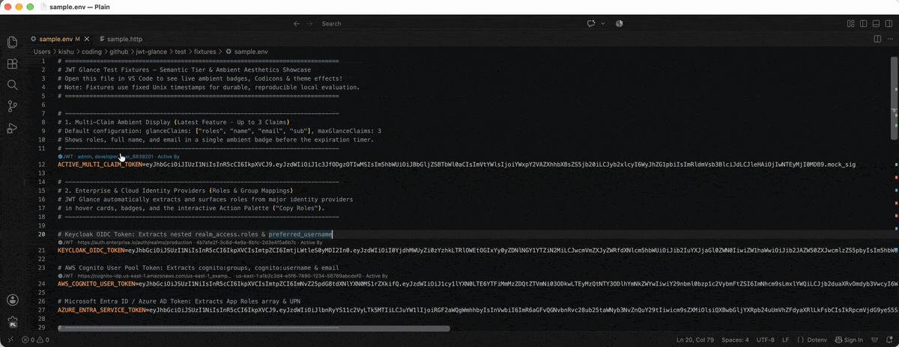
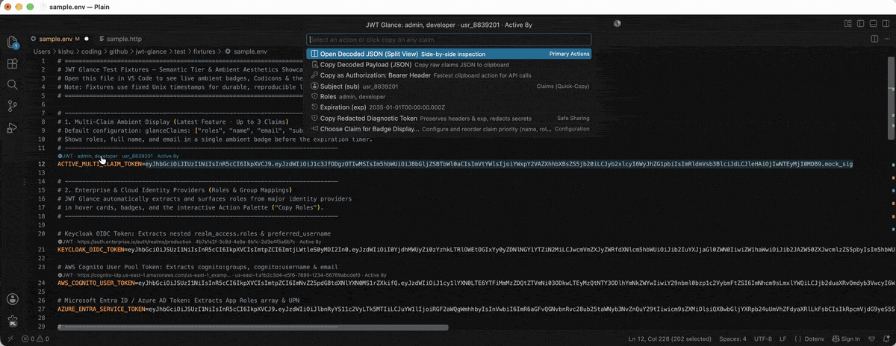
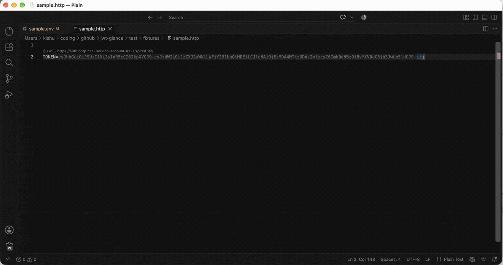
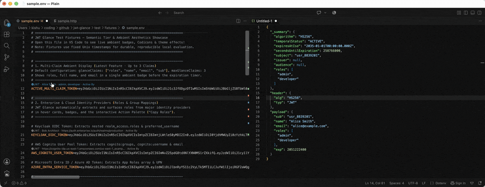

# JWT Glance

> **Zero-click ambient JWT inspection lens for VS Code.**
> *Compatible with VS Code-based editors through VSIX installation.*



JWT Glance automatically surfaces JWT expiration countdowns, algorithm details, and decoded claim cards directly within your editor—eliminating the insecure reflex of pasting sensitive credentials into third-party web decoders and preventing cryptic `401 Unauthorized` test failures caused by stale fixtures.

---

## ✨ Features

- ⚡ **Ambient Badges & CodeLens:** See status at a glance—above the line (`top`), inline (`left`), or `both`—in `.env`, `.http`, `.rest`, `.json`, `.yml`, and code.
- 🎨 **Multi-Tier Semantic Visual Health:** Instant status recognition via Codicons (`$(pass-filled)` active, `$(clock)` expiring soon, `$(error)` expired, `$(shield) $(alert)` unsecured, `$(key)` permanent) in CodeLens, color-coded scrollbar markers, and theme-aware colored text for inline badges (`left`/`both`).
- 👻 **Dead Credential Text Dimming:** Expired tokens automatically dim to 55% opacity so stale credentials visually recede while remaining fully interactive.
- ⏱️ **60-Second Live Timer:** Relative expiry countdowns (`Active 42m` → `Active 41m`) refresh automatically every minute without full-file rescan overhead.
- 🎯 **Interactive Action Palette:** Click any badge (or press `Cmd+Shift+P` → *Inspect Token at Cursor*) to:
  - Open decoded JSON in split view with syntax formatting and folding.
  - Copy formatted `Authorization: Bearer <token>` header for API clients.
  - Quick-copy claims (`sub`, `iss`, `aud`, `exp`, roles) or the full payload JSON.
  - Export a redacted diagnostic token (safe for sharing in bug reports).
  - Open the claim priority editor to configure fallback claims (e.g. roles → email → sub) or custom nested paths.
- 🔍 **Rich Hover Cards:** Detailed popup with signature algorithm, key ID, exact ISO lifecycle timestamps, and formatted payload JSON.
- 🐨 **Footer Status Bar Toggle Icon:** Compact JWT Glance koala icon in the status bar footer (`$(jwt-glance)` / `$(jwt-glance-paused)`) for 1-click ambient inspection toggling.
- 👤 **Customizable Glance Claim Priority:** Configure claim priority (default: `["roles", "name", "email", "sub"]`) and max visible claims (`maxGlanceClaims`, 1–10). Set `maxGlanceClaims: 1` for single-claim display, or up to 10 for multi-claim display, with `sub` acting as final fallback.
- 📜 **Full-Document Overview Ruler:** Highlights tokens across the entire document in the scrollbar (with configurable cap to protect performance).
- 📋 **Clipboard Inspection:** Decode and inspect tokens straight from clipboard memory without saving them to disk.
- 🛡️ **Opt-In Workspace Policies:** Enforce token conformance locally against expected issuers, audiences, required claims, and max token age in the **Problems** panel.
- 🪶 **Zero Runtime Dependencies:** Strictly `"dependencies": {}`. Pure deterministic TypeScript core with fast startup.

---

## 🔒 Security, Privacy & Safe Redaction



- **100% Offline & Private:** Runs entirely locally in your editor. Zero telemetry, zero outbound network requests, and zero credential logging.
- **Decoding ≠ Cryptographic Verification:** Ambient inspection decodes structural claims for developer convenience. It does not verify cryptographic signatures—always verify signatures on your backend.
- **Safe Redaction:** *Copy Redacted Token* applies strict cryptographic allowlists: only safe string header fields (`alg`, `typ`, `cty`) and finite numeric timestamps (`exp`, `nbf`, `iat`) are preserved. All other headers (including `kid`) and custom payload claims are replaced with `"[REDACTED]"`, and the signature is replaced with `"REDACTED_SIGNATURE"` (preserving 2-segment token structures without fabricating a signature).
- **Clipboard Handling:** Copy actions write directly to the OS clipboard upon explicit user selection. Copying raw tokens or Bearer headers writes active credentials for immediate API workflows.

---

## 🚀 Quickstart

1. **Install** from the VS Code Marketplace or from a packaged `.vsix`.
2. **Open any file** containing JWTs (`.env`, `.http`, `.json`, `.yml`, `.ts`, `.py`)—badges appear automatically above or inline with tokens.
3. **Hover or Click:** Hover over any token for the detailed claim card, or click a badge to open the Action Palette.

---

## 🐨 Ambient Lens & 1-Click Status Bar Toggle



Pause or resume ambient decorations at any time without opening settings:
- **Status Bar Item:** Click the `$(jwt-glance)` / `$(jwt-glance-paused)` koala icon in the bottom-right footer.
- **Keyboard Shortcut / Command:** Run `JWT Glance: Toggle Ambient Lens` from the Command Palette (`Cmd+Shift+P`).

---

## 👤 Customizable Badge Claims & Priority



Customize which claims appear in your ambient badges and CodeLens:
- **Priority Order & Visibility:** Displays up to `maxGlanceClaims` matching claims (default: 3) in the exact order defined by `glanceClaims`.
- **Single-Claim vs Multi-Claim:** Set `maxGlanceClaims: 1` if you prefer showing only the single highest-priority matching claim.
- **Subject Fallback:** When `sub` is placed at the end of the list (e.g. `["roles", "name", "email", "sub"]`), it naturally serves as the final fallback when earlier claims are absent. Removing `sub` from the list suppresses subject display entirely.
- **Interactive Configuration:** Run **`JWT Glance: Choose Claim for Badge Display`** (or select it in the Action Palette) to interactively reorder claims, add detected token claims with one click, or enter custom nested dot paths (e.g. `user.profile.id`).

---

## ⌨️ Command Palette Reference (`Cmd+Shift+P` / `Ctrl+Shift+P`)

Access all actions quickly from the VS Code Command Palette:

| Command | Description |
| :--- | :--- |
| **`JWT Glance: Inspect Token at Cursor`** | Opens the interactive Action Palette for the token under cursor or selection. |
| **`JWT Glance: Choose Claim for Badge Display`** | Interactively reorder, add, and manage fallback claim priorities (e.g. roles → email → sub). |
| **`JWT Glance: Toggle Ambient Lens`** | Instantly toggles ambient CodeLens and inline badges on or off. |
| **`JWT Glance: Copy as Authorization: Bearer Header`** | Copies formatted `"Authorization: Bearer <token>"` header to clipboard for API clients. |
| **`JWT Glance: Inspect Token from Clipboard`** | Decodes a token straight from clipboard memory without saving to disk. |
| **`JWT Glance: Copy Redacted Token`** | Copies a safe diagnostic token with sensitive claims and signature redacted. |

---

## ⚙️ Configuration Settings

Configure JWT Glance using the single `"jwtGlance"` object in your VS Code `settings.json`:

```json
{
  "jwtGlance": {
    "enabled": true,
    "showStatusBarItem": true,
    "glanceClaims": ["roles", "name", "email", "sub"],
    "maxGlanceClaims": 3,
    "position": "top",
    "overviewRuler": true,
    "maxOverviewRulerTokens": 50,
    "dimExpiredTokens": true,
    "expiringSoonThreshold": 1800,
    "maxLineLength": 10000,
    "maxDocumentCharacters": 524288,
    "exclude": [
      "**/package-lock.json",
      "**/yarn.lock",
      "**/pnpm-lock.yaml",
      "**/*.min.*",
      "**/*.map"
    ],
    "languages": ["*"],
    "policies": []
  }
}
```

| Setting Property | Type | Default | Description |
| :--- | :--- | :--- | :--- |
| `enabled` | `boolean` | `true` | Enable or disable ambient glance badges and hover cards. |
| `showStatusBarItem` | `boolean` | `true` | Display a toggle icon in the status bar footer for 1-click toggling. |
| `glanceClaims` | `string[] \| string` | `["roles", "name", "email", "sub"]` | Priority claim keys to display in badges (e.g. `["roles", "name", "email", "sub"]`). Displays up to `maxGlanceClaims` matches. |
| `maxGlanceClaims` | `number` | `3` | Maximum number of claim fields to display simultaneously in ambient glance badges and CodeLens. |
| `position` | `'top' \| 'left' \| 'both'` | `'top'` | Badge position: `'top'` (native CodeLens above line), `'left'` (inline colored text), or `'both'` (CodeLens and inline text). |
| `overviewRuler` | `boolean` | `true` | Show token health indicators in the scrollbar overview ruler. |
| `maxOverviewRulerTokens` | `number` | `50` | Max tokens in overview ruler per file (`0` disables scrollbar markers). |
| `dimExpiredTokens` | `boolean` | `true` | Dim expired tokens (55% opacity) to visually separate dead credentials. |
| `expiringSoonThreshold` | `number` | `1800` | Seconds before expiration to show amber warning (default 30m). |
| `maxLineLength` | `number` | `10000` | Max characters per line to scan (prevents lag on minified files). |
| `maxDocumentCharacters` | `number` | `524288` | Max document size to scan (~512 KB) to maintain responsiveness. |
| `exclude` | `string[]` | `["**/package-lock.json", ...]` | Glob patterns of files to exclude from ambient scanning. |
| `languages` | `string[]` | `["*"]` | Language identifiers to scan (default `["*"]` for all languages). |
| `policies` | `array` | `[]` | Opt-in workspace policies for issuer, audience, and claim validation. |

*(Note: Legacy flat `"jwtGlance.<property>"` configurations are also supported for backwards compatibility).*

### 🎨 Visual Design & How Colors Work

JWT Glance is designed to integrate cleanly with any VS Code theme without cluttering your code:

- **Top Badge (`position: "top"`, default):** Rendered as native VS Code CodeLens directly above the token line. In VS Code, CodeLens text is styled in muted gray (`editorCodeLens.foreground`). Token health is indicated at a glance via Codicons (`$(pass-filled)` active, `$(clock)` expiring soon, `$(error)` expired, `$(shield) $(alert)` unsecured, `$(key)` permanent), dead credential text dimming, and scrollbar markers.
- **Scrollbar Overview Ruler (`overviewRuler: true`, default):** Displays color-coded health indicators in the editor's right scrollbar across all modes (green for active, amber for warning, red for expired/unsecured, cyan for permanent keys).
- **Inline Badge (`position: "left"` or `"both"`):** Displays clean colored text directly before the token using your theme's semantic colors (green, amber, red, etc.) with no background boxes, borders, or brackets.
- **Dead Credential Dimming (`dimExpiredTokens: true`, default):** Automatically dims expired tokens to 55% opacity so dead credentials visually recede while remaining fully clickable.

### Opt-In Workspace Policies Example

Enforce token conformance locally in `.vscode/settings.json` without outbound network calls:

```json
{
  "jwtGlance": {
    "policies": [
      {
        "name": "Local API Fixtures",
        "files": ["**/*.http", "**/.env*"],
        "issuer": "https://auth.company.com",
        "audience": "orders-api",
        "allowedAlgorithms": ["RS256", "ES256"],
        "requiredClaims": ["sub", "tenant_id", "exp"],
        "maximumTokenAgeSeconds": 86400,
        "requireExpiration": true
      }
    ]
  }
}
```

- **Scoped Validation:** Violations surface directly in the VS Code **Problems** panel and hover cards.
- **Smart Defaults:** Omitted `files` defaults to `["**/*.http", "**/.env*"]` and `requireExpiration` defaults to `true`.
- **Custom Claims & Max-Age:** Validates both registered and custom claims (`tenant_id`, etc.) and asserts token age against `iat` (with 60s clock skew tolerance).
- **Sanitized Hover Cards:** Policy warnings in hover cards are stripped of raw markdown to prevent spoofed links or headings.

> **Setting scope:** Workspace settings in `.vscode/settings.json` override user settings. Changes take effect immediately in open editors.

---

## 🤝 Contributing & Development

For development setup, local debugging (`F5`), test suites, and packaging instructions, see [CONTRIBUTING.md](CONTRIBUTING.md).

For security policies and vulnerability reporting, see [SECURITY.md](SECURITY.md).

---

## 📄 License

MIT © 2026 kcodek
